
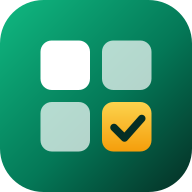

<h1 align="center">Nizam — all features · كل الميزات</h1>

Version 2.8.0 · <a href="#english">English</a> · <a href="#بالعربية">العربية</a>

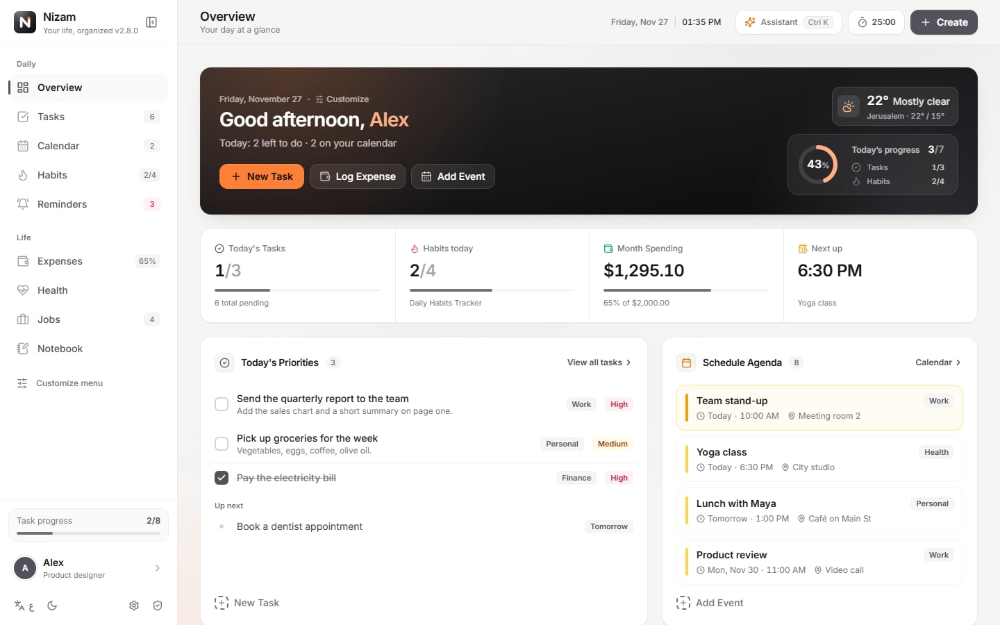

---

## English

### Contents

[Overview](#overview) · [Tasks](#tasks) · [Calendar](#calendar) · [Habits](#habits) · [Reminders](#reminders) · [Expenses](#expenses) · [Health](#health) · [Jobs](#jobs) · [Notebook](#notebook) · [Focus timer](#focus-timer) · [Assistant](#assistant-ctrl--k) · [Navigation](#navigation-and-layout) · [Appearance](#appearance) · [Effects](#effects) · [Desktop app](#desktop-app) · [Your data](#your-data) · [Languages](#languages-and-accessibility)

### Overview

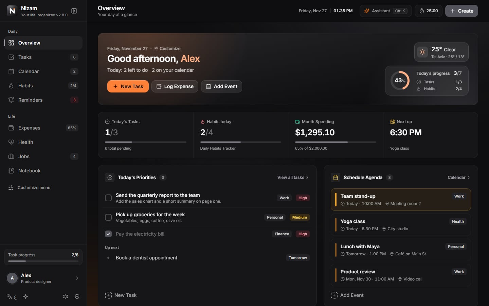

- **Greeting with your name** and a one-line summary of the day ("Today: 1 left to do · 2 on your calendar").
- **Weather:** your city, the sky outside and the temperature, with today's high and low. Click it to change the city.
- **Today's progress:** one ring for tasks + habits done today, with a breakdown.
- **Numbers strip:** today's tasks, habits, month spending and what's next on the calendar.
- **Cards:** today's priorities, schedule, today's reminders, *Did you know?*, budget and spending by category, habits check-in, health snapshot, job pipeline and quick notes.
- **Did you know?** A new general-knowledge fact each time you open the app (technology, space, science, history, geography, nature, the human body, language), with arrows for more. Works offline.
- **Customize it:** hide anything (weather, progress, quick actions, numbers strip, any card), drag cards into your own order and make each one narrow, wide or a full row. A live preview shows the result.

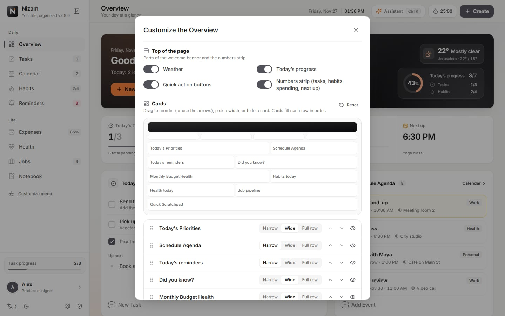

### Tasks

- Add, edit and delete with **undo**; priority, category, due date and description.
- Filters and search; tasks are **grouped by day** with a done / total count; older days fold away.
- "All done" state when the list is empty.

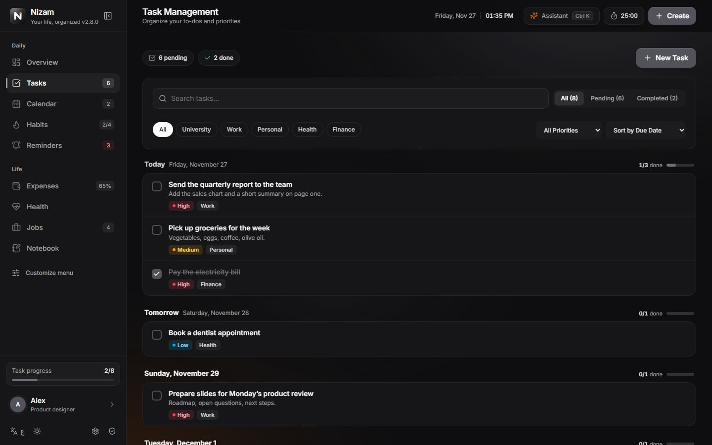

### Calendar

- Month grid with a per-day agenda; time, location and notes per event.
- **Google Calendar / Outlook subscriptions** through a private iCal link (desktop app): recurring events, time zones and exceptions handled, shown read-only in their own colour.

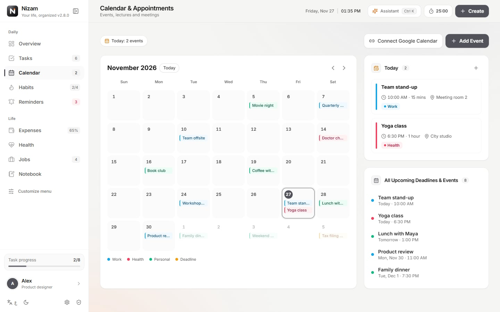

### Habits

- Daily check-in, current and best streak.
- **A whole year at a glance:** a heatmap per habit, darker on days you spent more time; switch years.
- **Time per habit:** +15 m, +30 m, +1 h or exact minutes, for any day; totals per habit and year.
- A colour, description and resource links (a course, a playlist) for each habit.
- Finished focus-timer sessions can count toward a habit.

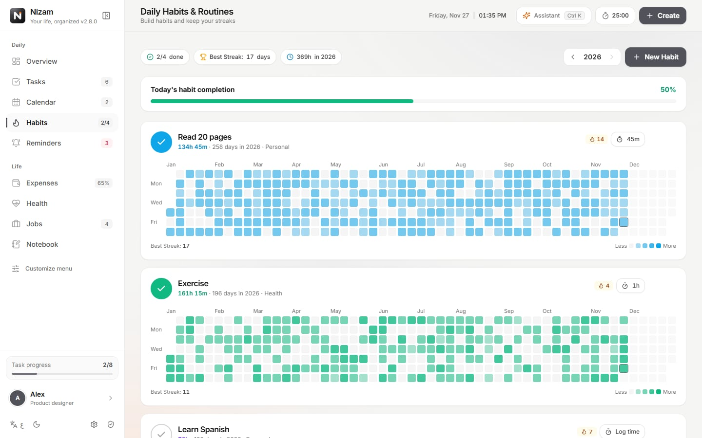

### Reminders

- **Recurring reminders with a notification at their time:** every day, every few days ("water the plants every 3 days") or on chosen weekdays ("call grandma on Friday and Monday").
- Today's reminders sit on the Overview and the Reminders page with a big tick; see the last 7 times (done or missed) and the next date.
- Pause and resume, edit, delete with undo; a note and a colour per reminder.
- If the app was closed at the reminder's time, it notifies as soon as it opens.

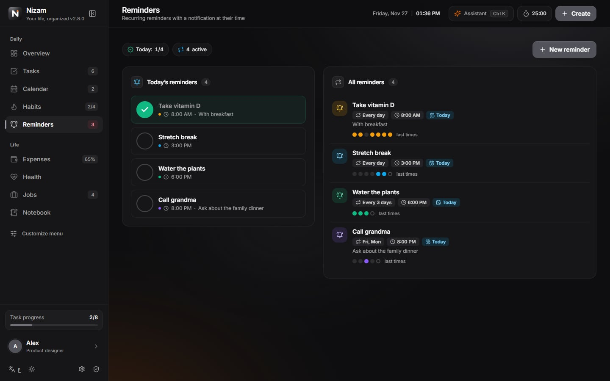

### Expenses

- Monthly budget, spending by category, browse months, trend chart, daily average and month-end projection, comparison with last month.
- **CSV export** that opens correctly in Excel (UTF-8).

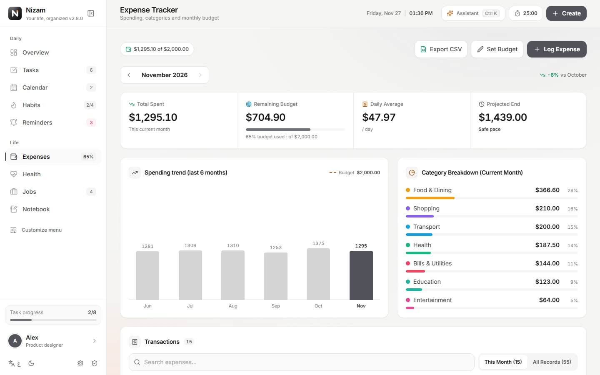

### Health

- **Food diary** per meal with calories and macros per food, servings, recent foods, copy yesterday's meal; calories from macros (4/4/9).
- **Personal calorie budget** from sex, age, height, weight, activity and weekly pace (Mifflin-St Jeor).
- **Exercise log** with calories from MET values: remaining = budget − food + exercise.
- Macro rings, 7-day chart, weekly under / over, weight trend with goal line and projected goal date, water.

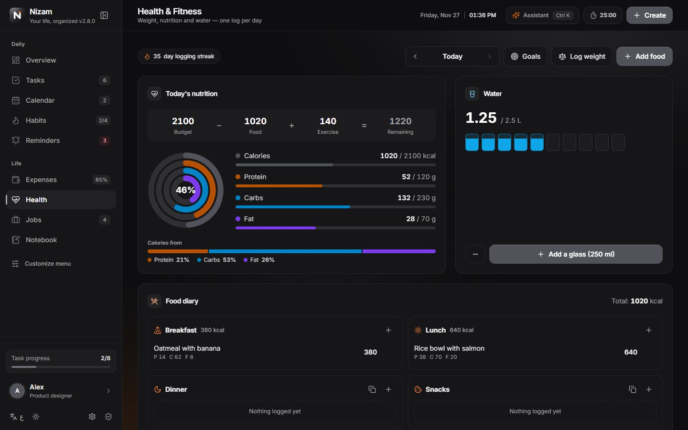

### Jobs

- Kanban board (Wishlist → Applied → Interviewing → Offer / Rejected) with drag and drop (mouse, touch, keyboard).
- Requirements, posting link, interview date and time with a reminder 15 minutes before.

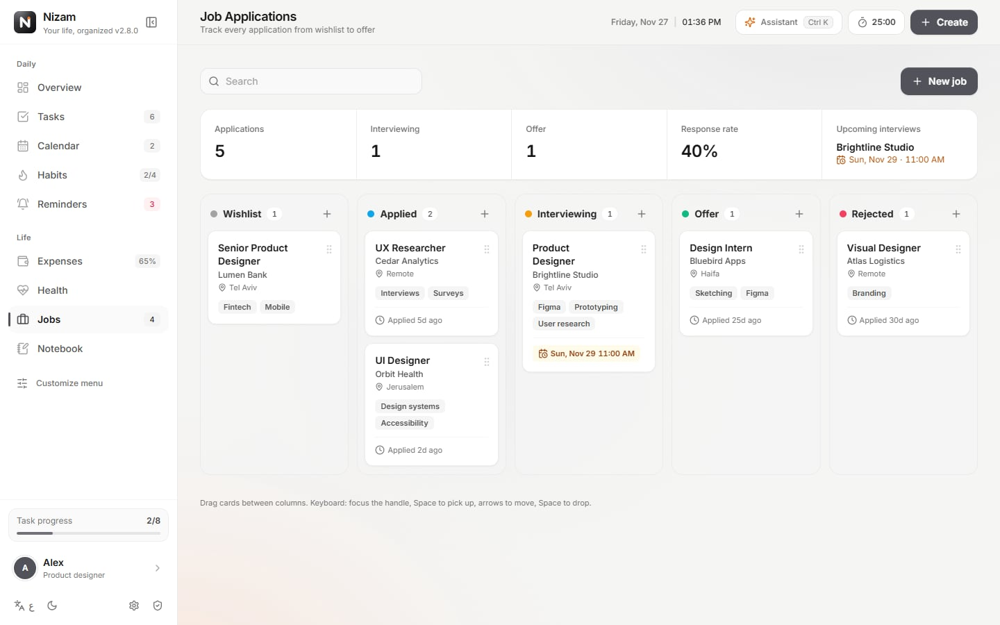

### Notebook

- Rich pages: headings, bold / italic / underline / highlight, lists and checklists, quotes, code, dividers; **/** opens the block menu.
- **Named links**, **images** (paste, drag, copy out, drag to the desktop or WhatsApp), **attached files** up to 25 MB (PDF viewer, video, audio, text in the page).
- **Drawing pen** over the page: pen, highlighter, eraser, colours and sizes, undo / redo.
- **Sources** section per page; plain, lined, grid or dotted paper with text on the lines.
- Full screen (Esc exits), page list on the left, right or hidden, customisable toolbar, **export a page as PDF**, Markdown download, pin, search, duplicate.
- Arabic and English in the same page: each paragraph follows its own direction.

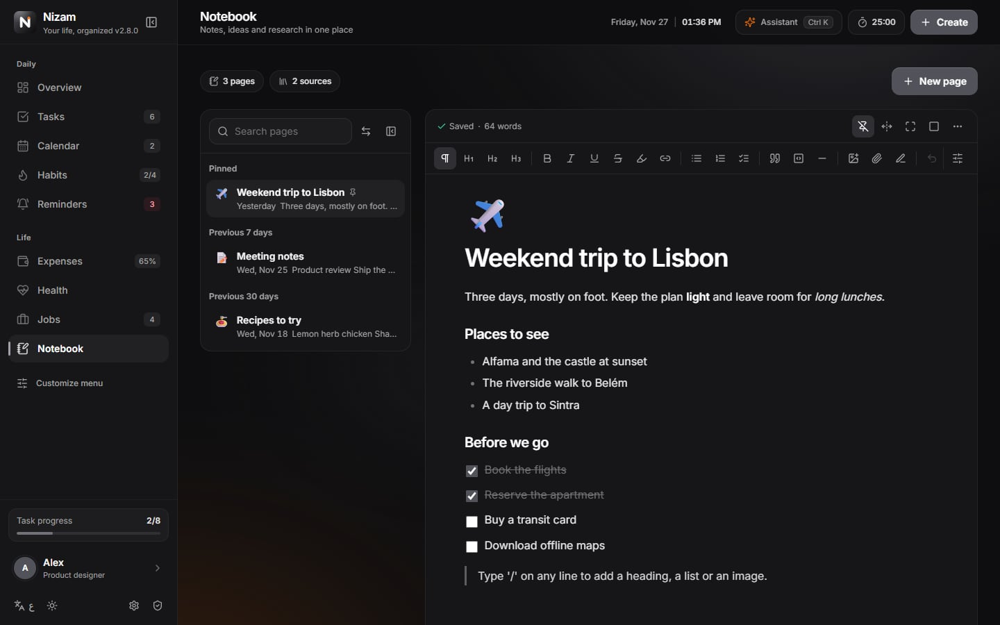

### Focus timer

- Focus / short break / long break, presets or any length up to 240 minutes, +5 minutes.
- Breaks start automatically, sessions counted per day; an in-app bubble and an always-on-top mini timer while the app is minimised (desktop).

### Assistant (Ctrl + K)

- Type a sentence in Arabic or English — "صرفت 25 شيكل على قهوة", "add task call the bank tomorrow" — and see exactly what will be created before pressing Enter.
- Also opens pages and settings, switches language or theme, exports data. Rule-based and on-device; voice input in Chrome / Edge.

### Navigation and layout

- **Collapsible sidebar:** shrink it to icons (Ctrl + \ or the panel button) so the open page gets the room; labels appear beside the icons on hover.
- **Your own menu:** reorder pages, move them between the Daily and Life groups, hide pages you don't use.
- Phones: a bottom tab bar (your first four pages + More), a floating create button and dialogs as bottom sheets.
- First run: a short welcome that explains the app, asks your name and city, then lets you start fresh, import a backup, restore an automatic backup or try sample data.

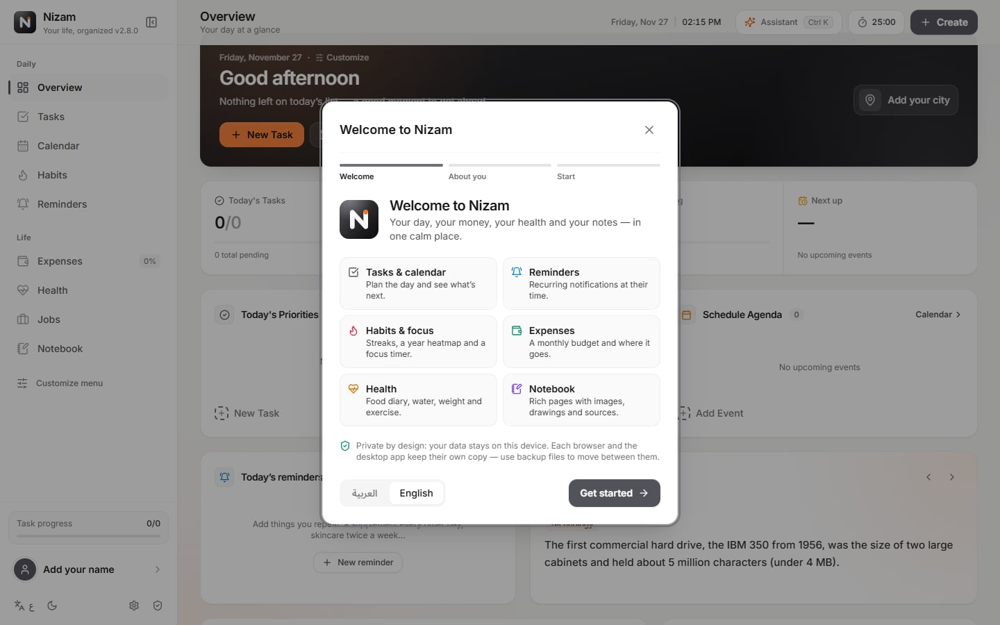

### Appearance

- **Design styles:** Classic, Flat and Soft (One UI).
- **Colour themes:** Forest & Gold, Azure & Navy, Nizam Indigo, Graphite. Light and dark mode.
- **7 Arabic + Latin fonts**, three text sizes, a *Reduce animations* switch.
- **Settings** in one large window with the sections listed on the side.

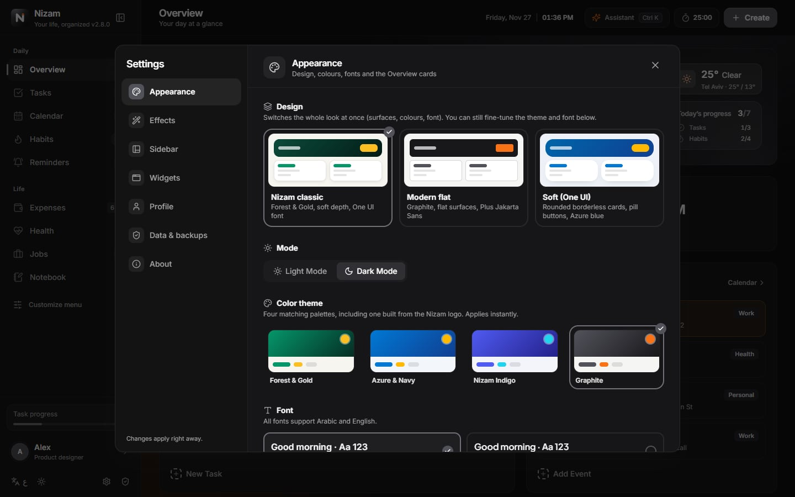

### Effects

- **Background art:** aurora, mesh, waves, contours, grid or dots in your theme's colours; still or animated; soft to bold. Pauses while typing, in dialogs and when the window is hidden.
- **See-through window** (Windows 11): Mica or Acrylic with three levels; cards become frosted panes.
- **Hover:** off, subtle or rich (clickable cards lift, rows grow a bar, buttons step and press).
- **Mouse pointer:** system, arrow or circle in your theme colour, two sizes.

### Desktop app

- Windows installer with **automatic updates**.
- **Desktop widgets:** notes, tasks, calendar, focus timer and habits as small windows that stay in sync with the app; pin any of them on top.
- **Start with Windows** (opens minimised).
- **Right-click menu** in the app: cut, copy, paste, paste as plain text, select all, undo / redo; open or copy links; copy images; search Google for the selected text.

### Your data

- **Everything stays on your device.** No account, no server, no tracking.
- **Automatic backups** (15 s after launch, then every 20 minutes when something changed) and a backup before every import, reset or restore. Restore any of them from Settings → Data & backups.
- **JSON export / import** to move between devices; notebook images and files included.
- Unreadable data is set aside, never thrown away; storage problems show a warning.
- Only optional online features: weather (Open-Meteo, the city you pick) and calendar subscriptions (the link you add).

### Languages and accessibility

- Arabic (right to left) and English, switch at any time; numbers always in Latin digits.
- Keyboard navigation, focus rings, screen-reader labels, 44 px touch targets, respects *reduce motion*.

---

## بالعربية

### المحتويات

[النظرة العامة](#النظرة-العامة) · [المهام](#المهام) · [التقويم](#التقويم) · [العادات](#العادات) · [التذكيرات](#التذكيرات) · [المصروفات](#المصروفات) · [الصحة](#الصحة) · [الوظائف](#الوظائف) · [الدفتر](#الدفتر) · [مؤقت التركيز](#مؤقت-التركيز) · [المساعد](#المساعد-ctrl--k) · [القائمة والتنقل](#القائمة-والتنقل) · [المظهر](#المظهر) · [المؤثرات](#المؤثرات) · [تطبيق سطح المكتب](#تطبيق-سطح-المكتب) · [بياناتك](#بياناتك)

### النظرة العامة

- **ترحيب باسمك** وملخص ليومك في سطر واحد.
- **الطقس:** اسم مدينتك وحالة الطقس ودرجة الحرارة مع العظمى والصغرى، واضغط عليه لتغيير المدينة.
- **تقدّم اليوم:** حلقة واحدة للمهام والعادات المنجزة.
- **شريط الأرقام:** مهام اليوم، العادات، مصروف الشهر، والموعد التالي.
- **البطاقات:** أولويات اليوم، جدول المواعيد، تذكيرات اليوم، «هل تعلم؟»، الميزانية، العادات، الصحة، مسار التوظيف، والملاحظات السريعة.
- **هل تعلم؟** معلومة عامة جديدة كل مرة تفتح التطبيق (تقنية، فضاء، علوم، تاريخ، جغرافيا، طبيعة، جسم الإنسان، لغة)، وتعمل بدون إنترنت.
- **خصّصها كما تحب:** أخفِ أي شيء، رتّب البطاقات بالسحب، واجعل كل بطاقة ضيقة أو عريضة أو بعرض السطر، مع معاينة مباشرة.

### المهام

- إضافة وتعديل وحذف مع **تراجع**، أولوية وتصنيف وتاريخ استحقاق ووصف.
- بحث وفلاتر، والمهام **مجمّعة حسب اليوم** مع عدد المنجز من الكل.

### التقويم

- شبكة شهرية مع مواعيد كل يوم، الوقت والمكان والملاحظات.
- **ربط تقويم Google أو Outlook** برابط iCal خاص (تطبيق سطح المكتب)، مع المواعيد المتكررة والمناطق الزمنية.

### العادات

- تسجيل يومي وسلسلة الإنجاز الحالية والأفضل.
- **السنة كاملة في نظرة:** خريطة حرارية لكل عادة، أغمق في الأيام التي قضيت فيها وقتًا أطول.
- **الوقت لكل عادة** لأي يوم، مع المجموع لكل عادة وكل سنة، ولون ووصف وروابط لكل عادة.
- جلسات مؤقت التركيز يمكن أن تُحسب لعادة.

### التذكيرات

- **تذكيرات دورية مع إشعار في موعدها:** كل يوم، أو كل عدة أيام (مثل سقي النباتات كل 3 أيام)، أو أيام محددة (مثل الاتصال بالجدة يومي الجمعة والاثنين).
- تذكيرات اليوم تظهر في النظرة العامة وصفحة التذكيرات مع زر «تم»، وترى آخر 7 مرات والموعد القادم.
- إيقاف مؤقت واستئناف وتعديل وحذف مع تراجع، وملاحظة ولون لكل تذكير.
- إذا كان التطبيق مغلقًا وقت التذكير، يظهر الإشعار فور فتحه.

### المصروفات

- ميزانية شهرية، الصرف حسب التصنيف، التنقل بين الأشهر، رسم الاتجاه، المعدل اليومي وتوقع نهاية الشهر، والمقارنة مع الشهر السابق.
- **تصدير CSV** يفتح بشكل صحيح في Excel.

### الصحة

- **يوميات الطعام** لكل وجبة بالسعرات والعناصر الغذائية.
- **ميزانية سعرات شخصية** من الجنس والعمر والطول والوزن والنشاط والهدف الأسبوعي.
- **سجل الرياضة** بالسعرات المحروقة، حلقات العناصر، رسم 7 أيام، الوزن مع خط الهدف وتاريخ الوصول المتوقع، والماء.

### الوظائف

- لوحة كانبان (قائمة الرغبات ← تم التقديم ← مقابلة ← عرض / مرفوض) بالسحب والإفلات.
- المتطلبات ورابط الإعلان وموعد المقابلة مع تذكير قبلها بربع ساعة.

### الدفتر

- صفحات منسّقة: عناوين، تنسيق النص، قوائم ومهام، اقتباس، كود، وفواصل؛ اكتب **/** لقائمة العناصر.
- **روابط بنص تختاره**، **صور** (لصق وسحب ونسخ وسحبها لسطح المكتب أو الواتساب)، و**ملفات مرفقة** حتى 25 ميغابايت.
- **قلم للرسم** فوق الصفحة مع ممحاة وألوان وأحجام.
- قسم **المصادر**، وورق سادة أو مسطّر أو مربعات أو نقاط والكتابة على السطور.
- ملء الشاشة، قائمة الصفحات يمين أو يسار أو مخفية، شريط أدوات قابل للتخصيص، و**تصدير الصفحة PDF**.

### مؤقت التركيز

- تركيز واستراحة قصيرة وطويلة بأي مدة حتى 240 دقيقة، واستراحات تبدأ تلقائيًا.
- فقاعة داخل التطبيق ومؤقت صغير فوق كل النوافذ عند تصغير التطبيق.

### المساعد (Ctrl + K)

- اكتب جملة بالعربي أو الإنجليزي، مثل «صرفت 25 شيكل على قهوة»، وترى بالضبط ما سيُضاف قبل الضغط على Enter. يعمل على جهازك بدون ذكاء اصطناعي سحابي.

### القائمة والتنقل

- **طيّ الشريط الجانبي** إلى أيقونات فقط (Ctrl + \) لتأخذ الصفحة مساحة أكبر.
- **قائمتك أنت:** رتّب الصفحات، انقلها بين «يومي» و«حياتي»، وأخفِ ما لا تستخدمه.
- عند أول تشغيل: تعريف قصير بالتطبيق، ثم اسمك ومدينتك، ثم تختار البدء من جديد أو استيراد نسخة أو بيانات تجريبية.

### المظهر

- ثلاثة أنماط تصميم (كلاسيكي، مسطّح، ناعم One UI)، أربع باقات ألوان، وضع فاتح وداكن، 7 خطوط عربية وإنجليزية، وثلاثة أحجام للنص.
- **الإعدادات** في نافذة واحدة كبيرة والأقسام على الجانب.

### المؤثرات

- خلفيات فنية بألوان الثيم، نافذة شفافة (ويندوز 11)، تأثيرات عند المرور بالماوس، ومؤشر ماوس بلون الثيم. كلها اختيارية.

### تطبيق سطح المكتب

- مثبّت ويندوز مع **تحديث تلقائي**.
- **ودجت على سطح المكتب:** الملاحظات، المهام، التقويم، المؤقت، والعادات، متزامنة مع التطبيق.
- التشغيل مع ويندوز، و**قائمة الزر الأيمن**: قص، نسخ، لصق، تحديد الكل، تراجع، فتح الروابط ونسخها، نسخ الصور، والبحث في Google.

### بياناتك

- **كل شيء على جهازك فقط.** بدون حساب وبدون خادم.
- **نسخ احتياطية تلقائية** ونسخة قبل كل استيراد أو استعادة، والاستعادة من الإعدادات.
- تصدير واستيراد ملف JSON للنقل بين الأجهزة، والصور والملفات معه.
- الميزات الوحيدة التي تتصل بالإنترنت اختيارية: الطقس (للمدينة التي تختارها) وربط التقويم.

---

© 2026 Omar Aqel · عمر عقل

